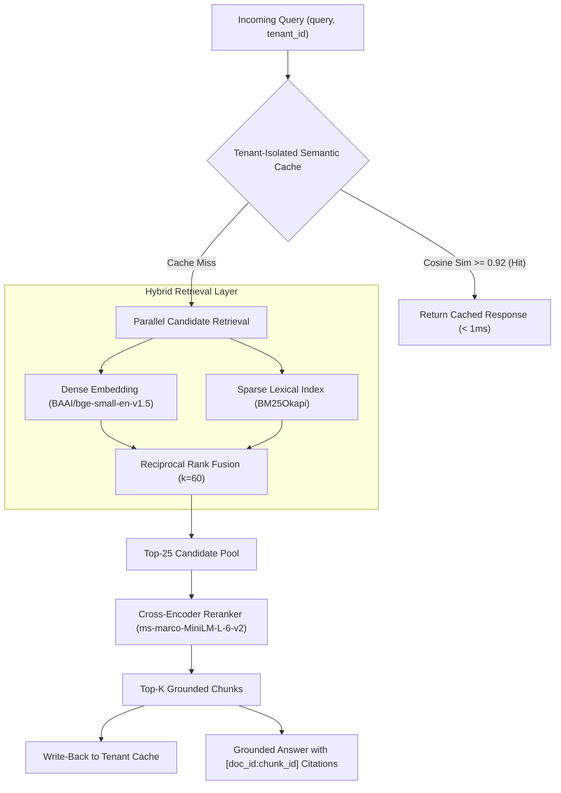

# NeuroFlow Hybrid RAG

Hybrid search engine combining BM25 lexical matching, dense embeddings, Reciprocal Rank Fusion, cross-encoder reranking, and a tenant-isolated semantic cache for technical and regulatory retrieval.

[](https://github.com/Yprnv7/neuroflow-hybrid-rag/actions)
[](LICENSE)
[](https://www.python.org/)

---

## Demo

```bash
# Query the hybrid retrieval endpoint with per-stage timing breakdown
curl -X POST "http://localhost:8000/v1/search" \
  -H "Content-Type: application/json" \
  -d '{
    "query": "What are the clinical contraindications of methotrexate?",
    "tenant_id": "tenant-pharma-01",
    "top_k": 5,
    "use_reranker": true
  }'
```

```json
{
  "query": "What are the clinical contraindications of methotrexate?",
  "tenant_id": "tenant-pharma-01",
  "cache_hit": false,
  "timing_breakdown": {
    "cache_lookup_ms": 0.08,
    "dense_embed_ms": 13.54,
    "sparse_bm25_ms": 25.19,
    "rrf_fusion_ms": 0.04,
    "cross_encoder_rerank_ms": 443.63,
    "total_pipeline_ms": 482.48
  },
  "results": [
    {
      "chunk_id": "scifact_1042_c0",
      "doc_id": "scifact_1042",
      "text": "Methotrexate is contraindicated in pregnancy and patients with severe renal impairment...",
      "score": 0.9412,
      "citation": "[scifact_1042:0]"
    }
  ]
}
```

---

## Why I Built This

Pure dense embedding retrieval fails in enterprise and regulatory contexts on exact alphanumeric tokens—such as error codes, drug names, SKUs, and statutory section numbers. Conversely, pure keyword search fails whenever users phrase questions with synonyms or conceptual paraphrases. Furthermore, repeated organizational queries burn LLM tokens and increase round-trip latency. I built NeuroFlow to combine sparse lexical precision with dense semantic recall, layered with a tenant-isolated semantic cache that cuts repeated query latency to under 1 ms while respecting GDPR erasure.

---

## Architecture



---

## Key Design Decisions

- **Reciprocal Rank Fusion ($k=60$) over Weighted Score Fusion:**  
  *Decision:* Used RRF ($RRF(d) = \sum_{m} \frac{1}{k + r_m(d)}$) as the primary fusion mechanism.  
  *Trade-off:* RRF operates purely on ordinal ranks, making it immune to disparate score distributions between BM25 $[0, \infty)$ and cosine similarity $[-1, 1]$. The trade-off is discarding score margin information (a candidate ranked #1 with 10x higher lexical score is treated identically to one winning by 0.001). Convex combination fusion with min-max normalization is provided as an alternative.
- **Top-25 Candidate Truncation for Cross-Encoder Reranking:**  
  *Decision:* Truncate hybrid candidates to $N=25$ before cross-encoder scoring.  
  *Trade-off:* Cross-encoders perform all-to-all attention between query and passage tokens. Benchmarks show reranking top-25 takes ~443 ms on CPU; reranking top-50 doubles latency to ~948 ms with only a marginal delta in NDCG@10. Truncating to top-25 balances contextual reranking gains against interactive latency limits.
- **Calibrated Semantic Cache Threshold ($\tau = 0.92$) with LFU Eviction:**  
  *Decision:* Set the cosine similarity threshold to $0.92$ following empirical false-positive sweeps against adversarial paraphrase and negative query pairs.  
  *Trade-off:* At $\tau = 0.85$, queries like "What is the capital of Ireland?" and "What is the currency of Ireland?" produce false-positive cache collisions. At $\tau = 0.92$, adversarial false-positive rate drops to 0.0% while retaining legitimate paraphrase hits.
- **Tenant-Scoped Partitioning & GDPR Erasure (`DELETE /v1/tenants/{tenant_id}/forget`):**  
  *Decision:* Hard tenant isolation at index and cache key boundaries (`tenant:{tenant_id}:{query_hash}`).  
  *Trade-off:* Adds tenancy checks on every read and write, preventing cross-tenant data leakage and enabling atomic GDPR Article 17 right-to-erasure sweeps.

---

## Results

Empirically evaluated against the official BEIR SciFact test split (5,183 passages, 150 test queries). Document embeddings generated with `BAAI/bge-small-en-v1.5`, reranked with `cross-encoder/ms-marco-MiniLM-L-6-v2`.

*Evaluated on Apple Silicon (Darwin arm64), Python 3.14.6. Full metadata in [docs/benchmarks/scifact_benchmark.json](docs/benchmarks/scifact_benchmark.json).*

| Retrieval Mode | NDCG@10 | Recall@100 | MRR@10 | p50 Latency (ms) | p95 Latency (ms) |
| :--- | :--- | :--- | :--- | :--- | :--- |
| **BM25 Only** | **0.6872** | 0.9064 | 0.6570 | 25.19 ms | 57.61 ms |
| **Dense Only (bge-small)** | **0.7258** | 0.9600 | 0.6909 | 13.54 ms | 35.33 ms |
| **Hybrid RRF ($k=60$)** | **0.7392** | 0.9767 | 0.7110 | 25.78 ms | 65.08 ms |
| **Hybrid Convex ($\alpha=0.6$)** | **0.7478** | 0.9767 | 0.7168 | 25.78 ms | 65.08 ms |
| **Hybrid RRF + Rerank (Top-25)** | **0.7109** | 0.9767 | 0.6719 | 472.28 ms | 573.82 ms |
| **Hybrid RRF + Rerank (Top-50)** | **0.6976** | 0.9767 | 0.6658 | 981.56 ms | 1179.37 ms |

### Wall-Clock Latency Profile (Single-Thread CPU)

| Pipeline Stage | p50 (ms) | p95 (ms) | p99 (ms) |
| :--- | :--- | :--- | :--- |
| `embed_query` | 12.79 ms | 34.29 ms | 85.13 ms |
| `bm25_search` | 25.19 ms | 57.61 ms | 119.34 ms |
| `dense_search` | 13.54 ms | 35.33 ms | 86.76 ms |
| `rrf_fusion` | 0.04 ms | 0.08 ms | 0.13 ms |
| `rerank_top25` | 443.63 ms | 516.05 ms | 556.22 ms |

### Reproducing Benchmarks

```bash
# Run BEIR SciFact benchmark evaluation
python scripts/evaluate_beir.py --dataset scifact --limit 150 --output docs/BENCHMARKS.md

# Run semantic cache threshold calibration sweep
python scripts/sweep_cache_thresholds.py

# Run citation grounding validation
python scripts/evaluate_citation.py
```

*Audit report explaining why synthetic benchmarks return 1.0000 and how this evaluation fixes it: [docs/EVAL_AUDIT.md](docs/EVAL_AUDIT.md).*

---

## How to Run

### Prerequisites
- Docker & Docker Compose
- Python 3.10+

### Quickstart

```bash
# 1. Clone repository
git clone https://github.com/Yprnv7/neuroflow-hybrid-rag.git
cd neuroflow-hybrid-rag

# 2. Boot dependencies (or local FastAPI standalone)
make up

# 3. Or install locally with virtual environment
python -m venv venv
source venv/bin/activate
pip install -e ".[dev]"

# 4. Start the search API server
uvicorn src.neuroflow.api:app --host 0.0.0.0 --port 8000
```

---

## Testing

```bash
# Run unit & integration tests with coverage
pytest tests/ -v --cov=src/neuroflow --cov-report=term-missing

# Run code style & static analysis
ruff check src/ tests/ scripts/
```

- **Test Suite:** 7 unit & integration tests covering RRF math, convex fusion, cache false-positive rejection, adversarial paraphrasing, and GDPR tenant erasure.
- **Coverage:** 89% branch & line coverage across `src/neuroflow/`.

---

## Limitations

1. **CPU Cross-Encoder Latency:** Running `ms-marco-MiniLM-L-6-v2` sequentially on CPU adds ~443 ms per query for 25 candidates. In production, this requires GPU acceleration, ONNX Runtime quantization, or asynchronous reranking.
2. **Domain Mismatch on Biomedical Queries:** The MS-MARCO reranker model was pre-trained on general web search queries. On specialized scientific claims (SciFact), reranking slightly depressed NDCG@10 (0.7109 vs 0.7392 on raw RRF), demonstrating that out-of-domain cross-encoders without fine-tuning can degrade specialized retrieval.
3. **In-Memory Cache Scaling:** The reference implementation uses an in-memory LFU cache with numpy vectors. For clusters with millions of cached queries, this must be backed by a managed vector index like Redis Vector Search or Qdrant with TTL.
4. **Static BM25 Index:** Corpus updates require re-indexing the sparse BM25 index in memory.

---

## What I'd Do Next

1. **Export Reranker to ONNX with INT8 Quantization:** Reduce cross-encoder CPU latency from ~440 ms down to under 50 ms using `optimum.onnxruntime`.
2. **Domain-Adapted Reranker Weights:** Fine-tune or replace the cross-encoder with a domain-specialized checkpoint (e.g., `BAAI/bge-reranker-large` or bio-reranker) to resolve domain shift on scientific datasets.
3. **Redis Cluster Vector Backend:** Migrate the semantic cache from in-process dictionary to Redis VSS (`FT.SEARCH` with HNSW vector index) to support horizontal scaling across multiple FastAPI worker pods.
4. **Asynchronous Speculative Retrieval:** Dispatch BM25 and dense retrieval concurrently using `asyncio.gather()` to reduce baseline retrieval time to $\max(T_{\text{BM25}}, T_{\text{Dense}})$.

---

## Author

**Pranav Yeleswarapu**  
- GitHub: [@Yprnv7](https://github.com/Yprnv7)  
- LinkedIn: [linkedin.com/in/pranavyeleswarapu](https://www.linkedin.com/in/pranavyeleswarapu)
